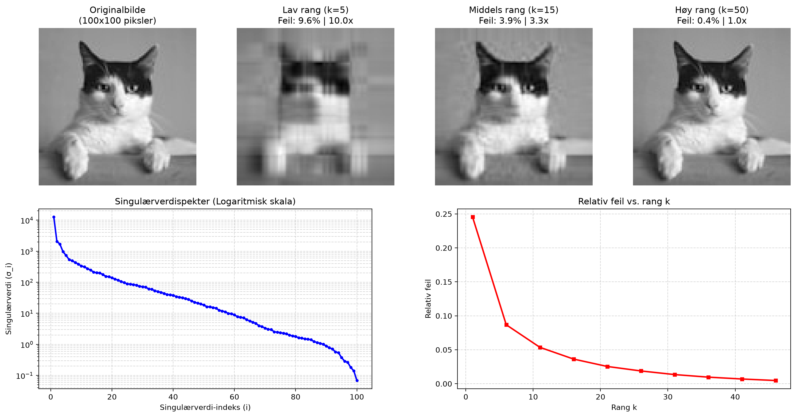

# Manual SVD Image Compression

This is a personal project buildt from scratch using singular value decomposition, low-rank matrix approximation, and power iteration, with error analysis, to compress images.

## Overview

Singular value decomposition factorizes a matrix $A$ into:

$A = U \Sigma V^T$

Where $U$ contains a orthonormal basis for column space of $A$, $V$ contains a orthonormal basis for row space of $A$, and $\Sigma$ is a diagonal matrix with the singularvalues of $A$. 

SVD is a powerful tool for low rank approximation of large matrixes. The largest k sigularvalues and corresponding orthonormal basis vectors in $U$ and $V$ contain most of the information stored in the matrix. Therefore it is possible to compress a matrix corresponding to an image without loosing significant detail in the photo, and draticaly redusing the amount of data stored.  

## A visual representation of SVD image compression

